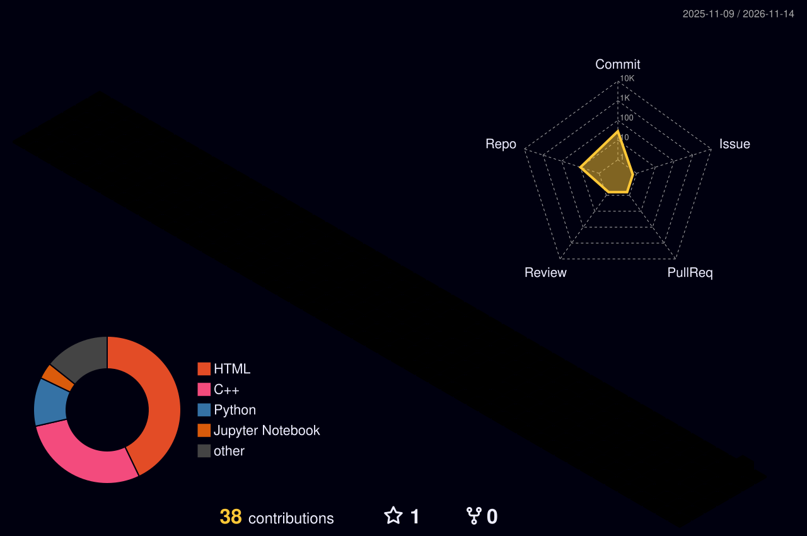

# Mohamed Badran

**Software, AI & Robotics Engineer · Alexandria, Egypt**

Training & Outreach Specialist (ICT Sector) at Bibliotheca Alexandrina · ITI Software Engineering Trainee

---

### About Me

I'm an engineer who works across software, AI, and connected hardware. I started in Production Engineering and embedded robotics, spent over five years building AI/IoT systems and teaching robotics to 2,000+ students at the Bibliotheca Alexandrina, and now work in the Library's **ICT Sector** on software QA, technical training, outreach, and release documentation—while training at the **Information Technology Institute (ITI)** in .NET Full-Stack and Generative AI engineering.

A lot of my work sits where software meets physical systems and real users: writing APIs and ML models, wiring microcontrollers, testing public web portals, setting up networks for 100+ devices, or running judging panels at national robotics championships.

---

### Tailored Portfolio Views

If you're visiting from a specific role or team, you can jump straight to the matching view on my website:

| Track | Focus | Portfolio Link |
| :--- | :--- | :--- |
| **Software, Web/App & AI** | ASP.NET Core, C#, Angular, Flutter, Python ML/GenAI (RAG, Agents, MCP), SQL, QA Testing | [mbadran0109.vercel.app/?track=software](https://mbadran0109.vercel.app/?track=software) |
| **Robotics, AI & Education** | Arduino/ESP32/ESP8266, IoT, Computer Vision, STEAM Curricula, National Head of Judges | [mbadran0109.vercel.app/?track=robotics](https://mbadran0109.vercel.app/?track=robotics) |
| **IT, 3D Design & Operations** | LAN/TCP-IP/DNS, API Automation, SolidWorks/Fusion 360/3D Printing, Production & Event Ops | [mbadran0109.vercel.app/?track=operations](https://mbadran0109.vercel.app/?track=operations) |

---

### What I'm Working On Right Now

- **Bibliotheca Alexandrina — ICT Sector (`Aug 2026 – Present`):** Training & Outreach Specialist in the Documentation, Training, and Outreach Unit. Testing newly released digital services and web portals, writing bug reports and release documentation, running internal technical/ICDL training for staff, and organizing ICT hackathons and events.
- **Information Technology Institute — ITI (`Oct 2026 – Present`):** Intensive Computer Software Engineering track covering ASP.NET Core, C#, C++, Web APIs, gRPC, EF Core, SQL Server, Angular, Docker, Azure, Semantic Kernel, RAG, AI Agents, MCP, n8n, and Microsoft Power Platform (Dynamics 365 & Power BI).
- **National Robotics Officiating (`2017 – Present`):** Served as **Head of Judges** across 4 main categories and their subcategories at both **ORCE** and **Robotourney Egypt** (`Nov 2026`), RoboParade Judge at **RoboFest Egypt** (`Sep 2026`), and Technical Judge for **FIRST LEGO League (FLL)** since 2020.

---

### Selected Projects

**Live on GitHub**
- [**Automated Smart Manuscript Showcase System**](https://github.com/mbadran0109/AutomatedSmartManuscriptShowcaseSystem) — Arduino Mega & ESP8266 triple-circuit micro-climate control and adaptive lighting system for preserving historical manuscripts (built with Team Canopix for FLL Unearthed).
- [**Face Detection & Recognition (ESP32-CAM)**](https://github.com/mbadran0109/FaceDetectionESP32) — Python computer vision pipeline pulling live frames from an ESP32-CAM to recognize faces and trigger automated hardware/voice responses.
- [**Grinch Museum AI Chatbot**](https://github.com/mbadran0109/Grinch-Museum-AI-Chatbot) & [**Web Portal**](https://github.com/mbadran0109/Grinch-Museum-Website) — Interactive museum guide chatbot with voice output and conversation memory, paired with a companion exhibit site.
- [**Multi-Track Portfolio Website**](https://github.com/mbadran0109/PortofolioWebsite) — Static HTML/CSS/JS portfolio with URL-based career track filtering (`?track=`), shared component hydration, lightbox gallery, and EmailJS v4 contact integration.
- [**ITI C++ OOP & Win32 Console Labs**](https://github.com/mbadran0109/iti-cpp-lab4) · [**MagicBox-CPP**](https://github.com/mbadran0109/MagicBox-CPP) · [**MenuSelector**](https://github.com/mbadran0109/MenuSelector) — C++ coursework covering dynamic memory, console line editors, Turtle Graphics, and Win32 cursor/keyboard handling.

**Earlier Hardware & AI Builds** *(archived locally — uploading to GitHub soon)*
- **Industrial AI Graduation Project (Grade: A):** Predictive regression and ML models for manufacturing cost estimation, product lifecycle workflows, and predictive maintenance planning.
- **Employee Attrition Prediction (IBM / DEPI Capstone):** End-to-end Python ML analysis and attrition forecasting pipeline.
- **Autonomous Environmental Research Rover:** Solar-tracking rover prototype with autonomous navigation and real-time gas/environmental sensors.
- **Smart Home & Garage Automation:** Bluetooth-controlled residential automation setup with elevator mechanics, lighting, and fire safety triggers.
- **Manuscript OCR & Age/Gender Detection:** Computer vision tools built with Python, TensorFlow, OpenCV, and DeepFace.

---

### Technical Stack

- **Software & Web/Mobile:** C#, ASP.NET Core, Web APIs, gRPC, EF Core, C++, Angular, Flutter/Dart, HTML5, CSS3, JavaScript, SQL / SQL Server, Software QA & Testing
- **AI & Data Science:** Python (Pandas, NumPy, Scikit-learn), TensorFlow, OpenCV, DeepFace, Semantic Kernel, RAG, AI Agents, MCP, MLflow, Hugging Face, n8n, Power BI
- **Robotics, Embedded & 3D:** Arduino, ESP32 / ESP8266, IoT Integration, Circuit Prototyping, SolidWorks, Fusion 360, AutoCAD, 3D Printing (Cura)
- **IT, Cloud & Operations:** Docker, Microsoft Azure, LAN / TCP-IP / DNS, Live AV & Streaming, API Workflow Automation, Production Planning & Supply Chain
- **Languages:** Arabic (Native), English (Fluent), German (Basic), Italian (Basic)

---

### Education

- **Computer Software Engineering** — Information Technology Institute (ITI) · *Oct 2026 – Present*
- **AI & Data Science – Data Scientist (DEPI)** — MCIT, Skills Dynamix & IBM · *Jun 2025 – Dec 2025*
- **B.Sc. in Production Engineering** — Alexandria University · *Sep 2019 – Dec 2025* *(Graduation Project: AI Models in Industrial Aspects — Grade: A)*

---

  

  

